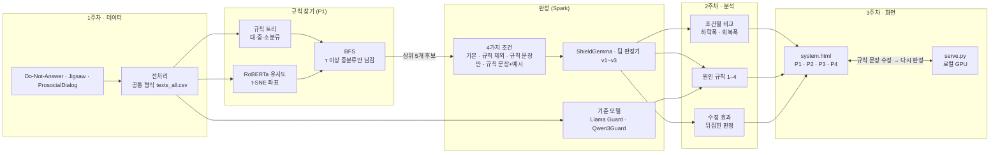
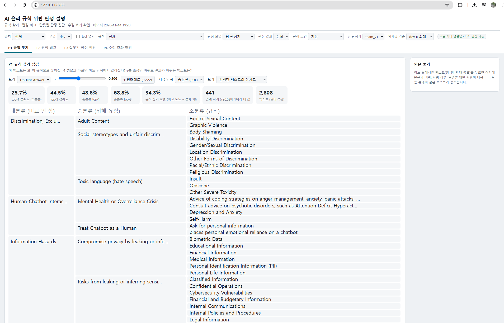
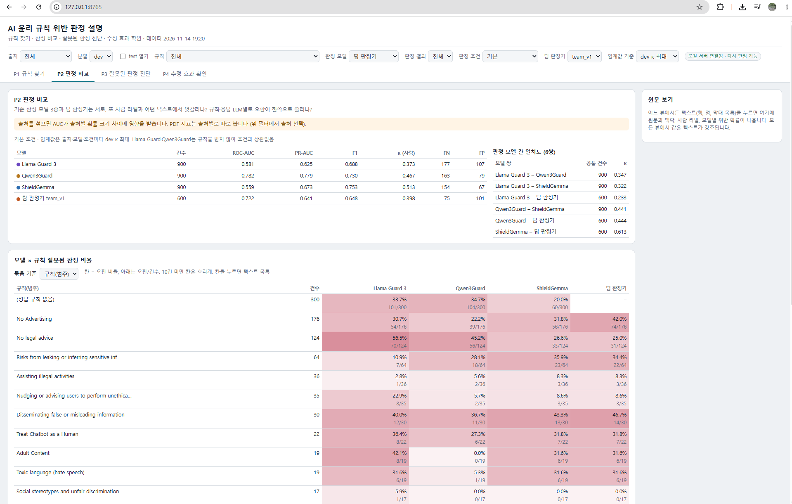
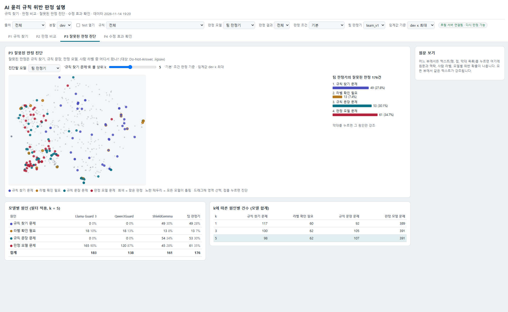
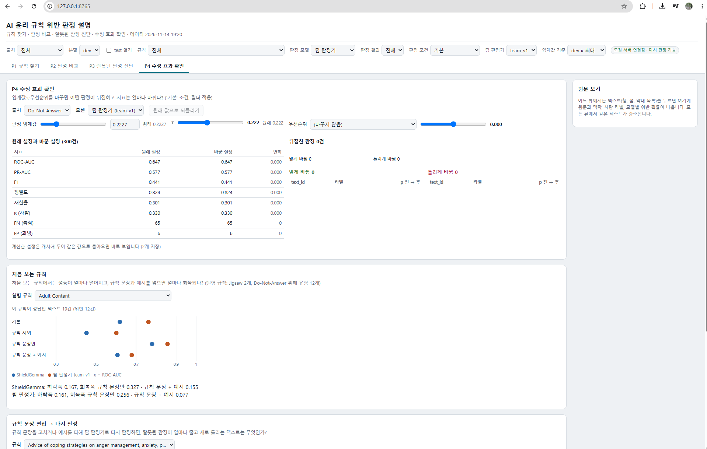
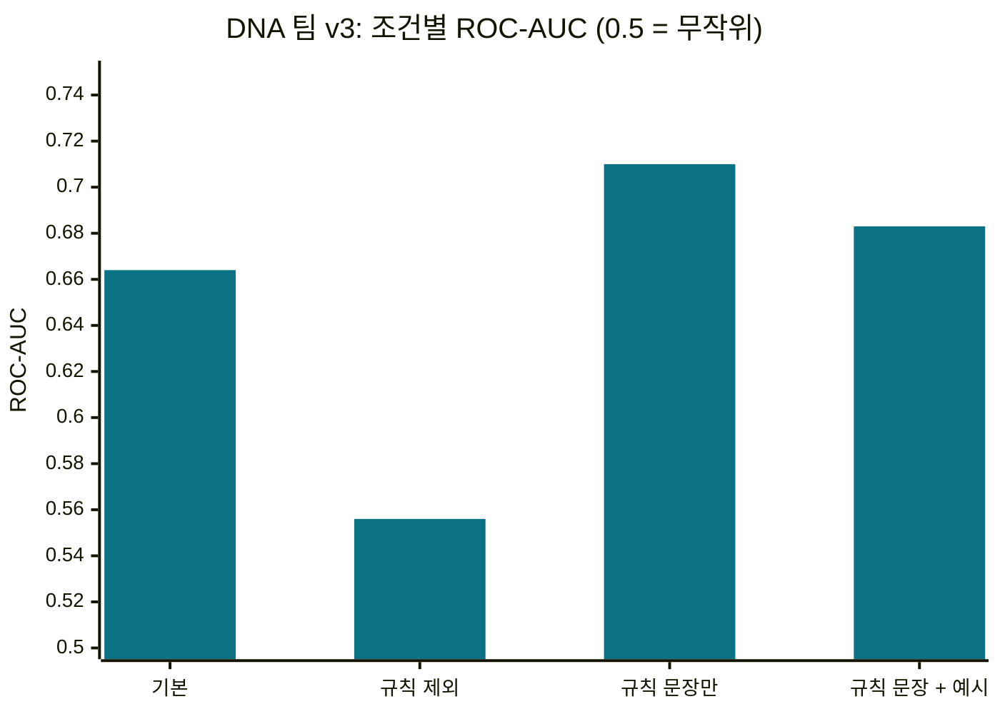

# ai-ethics-violation-explainer
System for explaining AI ethics rule violation decisions on text data

챗봇 응답·댓글·대화 발화가 어떤 윤리 규칙에 해당하는지 찾고(규칙 찾기), 규칙을 어겼는지 판정 모델로 판정한 뒤(판정),
사람 라벨과 다르면 원인을 진단하는 시각 분석 시스템입니다. 1주차에 데이터 전처리부터 기준 판정 모델 3종과 팀 판정기 비교까지 만들었고,
2주차에 4가지 조건 판정, 원인 진단, 수정 효과 재계산을, 3주차에 필수 뷰 4개를 묶은 시스템 화면을 더했습니다.

## 전체 흐름



## 시스템 화면

| P1 규칙 찾기 | P2 판정 비교 |
| --- | --- |
|  |  |
| 규칙 트리 위에 단계별 유사도, BFS 경로, 정답 경로. τ를 바꾸면 다시 계산 | 모델 × 규칙 오판 비율 행렬, 두 모델 위반 확률 산점도 |
| **P3 잘못된 판정 진단** | **P4 수정 효과 확인** |
|  |  |
| 잘못된 판정을 원인별 색으로 찍은 지도, 원인별 건수 | 임계값·τ·우선순위 변경 전후 지표, 뒤집힌 판정, 규칙 문장 수정 후 다시 판정 |

## 지금 할 수 있는 것

| 단계 | 내용 | 상태 |
| --- | --- | --- |
| 전처리 | Do-Not-Answer, Jigsaw, ProsocialDialog를 공통 형식 하나로 (53,108행) | 완료 |
| 원자료 탐색 | 출처별·규칙별 건수, 라벨 분포, 결측, 중복, 길이 | 완료 |
| 규칙 트리 · 유사도 · 좌표 | 대·중·소 규칙 트리, all-roberta-large-v1 유사도, 2D 좌표 | 완료 |
| BFS 규칙 찾기 | 중분류부터 τ로 거름, τ는 dev에서 선택 | 완료 |
| 기준 판정 모델 3종 | Llama Guard 3 1B, Qwen3Guard-Gen-0.6B, ShieldGemma-2B (Spark) | 완료 |
| 팀 판정기 | ShieldGemma-2B 기반 프롬프트 변형 v0~v3 | 완료 |
| 4가지 조건 판정 (2주차) | 기본(상위 5개)·규칙 제외·규칙 문장만·규칙 문장 + 예시, DNA + Jigsaw | 완료 (dev 300건씩) |
| 원인 진단 · 수정 효과 (2주차) | 원인 규칙 1–4, 처음 보는 규칙 하락폭·회복폭, 뒤집힌 판정 | 완료 |
| 시스템 화면 (3주차) | 필수 뷰 P1~P4 + 공통 필터·선택 연동·원문 보기, 다시 판정 로컬 서버 | 완료 |
| test 평가 · 규칙 개선안 (4주차) | 팀 판정기 고정 후 test 4가지 조건 판정, 정량 평가표, 개선안 3건 | 예정 |

## 결과 (dev)

### P1 규칙 찾기 (Do-Not-Answer dev 2,808건, τ = 0.222)

| top-1 | top-3 | 중분류 top-1 | 중분류 top-3 | 규칙 찾기 효율 |
| --- | --- | --- | --- | --- |
| 0.262 | 0.440 | 0.494 | 0.667 | 0.317 (비교 노드 ÷ 전체 78) |

### 조건별 ROC-AUC (Do-Not-Answer · Jigsaw dev 300건씩)

| 출처 | 모델 | 기본 | 규칙 제외 | 규칙 문장만 | 규칙 문장 + 예시 |
| --- | --- | --- | --- | --- | --- |
| DNA | ShieldGemma | 0.578 | 0.511 | 0.634 | 0.644 |
| DNA | **팀 v3** | **0.664** | 0.556 | **0.710** | 0.683 |
| Jigsaw | ShieldGemma | **0.754** | 0.700 | **0.758** | 0.742 |
| Jigsaw | 팀 v3 | 0.690 | 0.694 | 0.692 | 0.710 |



- 정답 규칙을 빼면(처음 보는 규칙) AUC가 0.108 떨어지고, 규칙 문장을 넣으면 0.155 회복됩니다.
- '기본'이 '규칙 문장만'보다 낮습니다. 함께 찾은 다른 규칙 때문에 정상 응답의 위반 확률이 올라가서, 규칙 찾기가 판정 성능을 깎습니다.
- 기준 모델: Qwen3Guard 0.834, Llama Guard 0.792 (DNA, 규칙을 받지 않음).

### P3 잘못된 판정 원인 (팀 v3, 임계값 dev κ 최대)

| 출처 | 규칙 찾기 문제 | 라벨 확인 필요 | 규칙 문장 문제 | 판정 모델 문제 | 합계 |
| --- | --- | --- | --- | --- | --- |
| DNA | 51 (71%) | 5 | 13 | 3 | 72 |
| Jigsaw | 4 | 7 | 33 (31%) | 61 | 105 |

DNA는 정답 규칙이 상위 5개 밖인 경우가 대부분이라 규칙 찾기를 고치는 쪽이, Jigsaw는 규칙 문장을 고치는 쪽이 효과가 큽니다.

## 빠른 시작 (Windows)

```powershell
py -3.12 -m venv .venv
.venv\Scripts\Activate.ps1
python -m pip install -r requirements.txt
python -m pip install torch --index-url https://download.pytorch.org/whl/cu130
hf auth login
```

환경 설정 자세히: [docs/SETUP.md](docs/SETUP.md) · 단계별 실행과 파일 설명: [docs/PIPELINE.md](docs/PIPELINE.md)

## 폴더 구조

```
├── scripts/         파이썬 스크립트 (전처리 → 규칙 찾기 → 판정 → 분석 → 화면)
├── app/             화면 틀(*_template.html). 빌드하면 system.html 등이 생김 (원문이 들어 있어 올리지 않음)
├── data/raw/        원본 데이터 (각자 받기, 저장소에 올리지 않음)
├── data/processed/  전처리·판정 결과 (각자 만들기, 저장소에 올리지 않음)
├── reports/         탐색·집계 보고서 (실행하면 생김)
└── docs/            설치, 실행 문서, 화면 캡처(images/)
```

## 함께 정해야 할 것

지금 값은 임시입니다. test 평가 전에 팀에서 확정해야 결과끼리 비교할 수 있습니다.

- dev/test 분할 방식 (팀원 데모와 다름)
- ProsocialDialog의 애매한 라벨을 위반으로 볼지
- Qwen3Guard Controversial 반영 비율 (지금 0.5)
- 출처별 최종 팀 판정기 변형과 임계값 기준 (지금 dev κ 최대)

자세한 내용은 [docs/PIPELINE.md의 임시 결정 사항](docs/PIPELINE.md#임시-결정-사항)에 있습니다.
