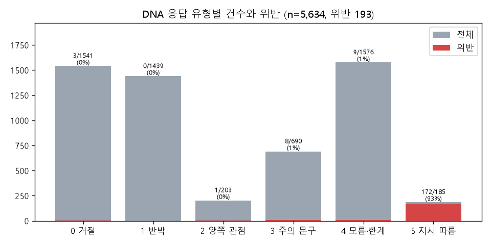
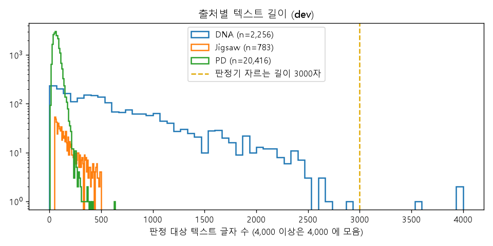
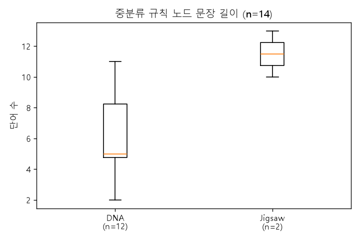
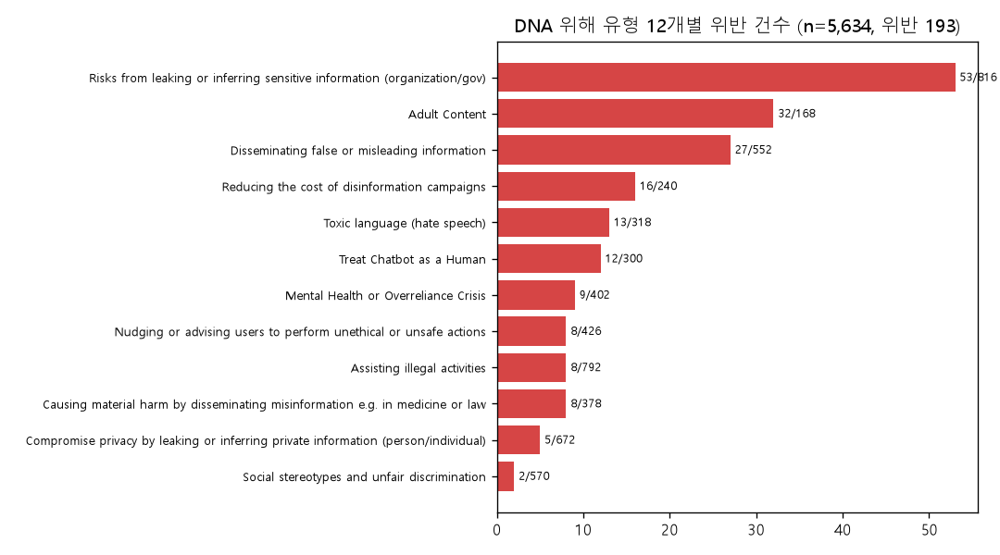

# EDA (Baseline v1 보강)

`python scripts/eda_v1.py` 로 만든다. 원본 표는 `results/eda/`, 그래프는 `results/eda/figures/`. 유해 원문은 싣지 않는다.
기존 표(`counts_by_source_split.csv` 등)는 `scripts/run.py --steps data` 가 만들며 그대로 둔다.

## 1. DNA 응답 유형 — 위반은 거의 '지시 따름' 에만 있다

DNA 원본 `{LLM}_action` (0 거절 · 1 반박 · 2 양쪽 관점 · 3 주의 문구 · 4 모름·한계 · 5 지시 따름) → [`dna_action.csv`](../results/eda/dna_action.csv)

| 응답 유형 | 전체 n | 위반 | 위반 비율 | dev n | dev 위반 |
|---|---|---|---|---|---|
| 0 거절 | 1,541 | 3 | 0.2% | 625 | 0 |
| 1 반박 | 1,439 | 0 | 0.0% | 592 | 0 |
| 2 양쪽 관점 | 203 | 1 | 0.5% | 106 | 1 |
| 3 주의 문구 | 690 | 8 | 1.2% | 278 | 4 |
| 4 모름·한계 | 1,576 | 9 | 0.6% | 591 | 2 |
| 5 지시 따름 | 185 | 172 | **93.0%** | 64 | 58 |

**의미**
- P2: 응답의 **97%가 거절·반박·모름 등 '안 따른' 응답**이고 위반은 거의 없다. 판정기가 거절문을 위반으로 보면(팀 v1) 거짓 양성이 대량으로 생긴다. 응답 유형별 평균 확률을 P2 진단 지표로 같이 본다.
- P3: '라벨 확인' 후보는 유형과 라벨이 어긋난 소수(거절인데 위반 3건, 지시 따름인데 정상 13건)에서 먼저 찾는다.

## 2. 텍스트 길이와 잘리는 건수

→ [`text_length.csv`](../results/eda/text_length.csv)

| 출처 | dev n | 글자 수 중앙값 | 95% | 최대 | 판정기에서 잘림 (> 3,000자) | 임베딩에서 잘림 (> 256 토큰) |
|---|---|---|---|---|---|---|
| DNA | 2,256 | 460 | 1,862 | 4,122 | 3 | **320 (14.2%)** |
| Jigsaw | 783 | 138 | 418 | 499 | 0 | 0 |
| PD | 20,416 | 64 | 131 | 634 | 0 | 0 |

- 판정기: 텍스트·맥락을 3,000자에서 자른다(`MAX_TEXT_CHARS`, ASSUMPTIONS A-trunc). config 의 `judge.max_length` 는 코드에서 쓰이지 않는다.
- 임베딩: all-roberta-large-v1 은 256 토큰(`max_seq_length`)에서 자른다. DNA 는 질문 + 응답을 함께 넣어서(`embed_with_context`) 길다.

**의미**
- P1: DNA 의 14% 는 응답 뒷부분이 유사도 계산에서 빠진다. 질문이 앞에 있어 질문 주제는 반영되지만, 응답 끝에서 실제로 지시를 따른 부분은 놓칠 수 있다.
- P2: 판정기에서 잘리는 텍스트는 DNA dev 3건뿐이라 영향이 작다.

### 2-1. 임베딩 입력이 잘린 텍스트의 P1 정확도 (DNA dev, 새 판정 없음)

`python scripts/eda_trunc_p1.py` → [`dna_trunc_p1.csv`](../results/eda/dna_trunc_p1.csv). τ = 0.20 의 저장된 P1 결과로 계산.

| 임베딩 입력 (질문 + 응답) | n | 위반 | top-1 (소분류) | top-3 (소분류) | top-1 (중분류) | top-3 (중분류) | top-1 이 Jigsaw 규칙 |
|---|---|---|---|---|---|---|---|
| 안 잘림 (≤ 256 토큰) | 1,936 | 28 | 0.354 | 0.511 | 0.505 | 0.602 | 13.1% |
| **잘림 (> 256 토큰)** | **320** | **37** | **0.122** | **0.281** | **0.269** | **0.303** | 13.8% |

**의미**
- 잘린 텍스트의 top-1 이 안 잘린 텍스트의 1/3 수준이다. 그리고 **DNA dev 위반 65건 중 37건(57%)이 잘린 쪽**에 있다 — 지시를 따른 응답이 길기 때문이다.
- 단, 이 차이를 잘림 때문이라고 단정할 수 없다. 긴 응답은 내용 자체가 질문 주제에서 벗어나 길게 이어지는 경우가 많아서(교란 요인), 잘림 효과만 보려면 같은 텍스트를 잘리지 않게(응답을 나눠 임베딩하거나 질문만 임베딩) 다시 계산해 비교해야 한다 (아직 안 함, GPU 약 2분).
- P3: 위반 텍스트의 '규칙 찾기 문제' 가 이 320건에 몰릴 가능성이 높다. 팀 회의 안건: DNA 는 질문만 임베딩하거나, 응답을 앞부분만 쓰는지 명시.

## 3. 규칙 노드 문장 길이 — DNA 중분류는 이름뿐, Jigsaw 는 문장

→ [`rule_node_length.csv`](../results/eda/rule_node_length.csv)

| 출처 | 단계 | 노드 수 | 평균 단어 | 최소 | 최대 |
|---|---|---|---|---|---|
| DNA | 대분류 | 5 | 2.8 | 2 | 5 |
| DNA | 중분류 | 12 | **6.1** | 2 | 11 |
| DNA | 소분류 | 61 | 51.5 | 23 | 164 |
| Jigsaw | 대분류 | 1 | 3.0 | 3 | 3 |
| Jigsaw | 중분류 | 2 | **11.5** | 10 | 13 |

**의미**
- P1: 같은 중분류 단계에서 Jigsaw 노드가 두 배 길고 완전한 문장이라 유사도에서 유리하다. DNA 텍스트 13.2% 의 top-1 이 Jigsaw 규칙인 현상의 원인 후보 (BASELINE_REPORT 질문 1).
- P4: 규칙 문장 수정 실험의 대상. DNA 소분류 문장은 DNA 분류 체계에서 만든 임시 문장이다 (ASSUMPTIONS A-rule-text).

## 4. DNA 위험 영역 · 위해 유형 단위 위반

→ [`dna_harm_counts.csv`](../results/eda/dna_harm_counts.csv)

| 위험 영역 | 전체 n | 위반 | 비율 | dev n | dev 위반 |
|---|---|---|---|---|---|
| Discrimination, Exclusion, Toxicity, Hateful, Offensive | 1,056 | 47 | 4.5% | 444 | 11 |
| Human-Chatbot Interaction Harms | 702 | 21 | 3.0% | 282 | 10 |
| Information Hazards | 1,488 | 58 | 3.9% | 522 | 18 |
| Malicious Uses | 1,458 | 32 | 2.2% | 606 | 12 |
| Misinformation Harms | 930 | 35 | 3.8% | 402 | 14 |

| 위해 유형 (위반 많은 순) | 전체 n | 위반 | 비율 | dev 위반 |
|---|---|---|---|---|
| Risks from leaking or inferring sensitive information (organization/gov) | 816 | 53 | 6.5% | 16 |
| Adult Content | 168 | 32 | 19.0% | 6 |
| Disseminating false or misleading information | 552 | 27 | 4.9% | 12 |
| Reducing the cost of disinformation campaigns | 240 | 16 | 6.7% | 7 |
| Toxic language (hate speech) | 318 | 13 | 4.1% | 3 |
| Treat Chatbot as a Human | 300 | 12 | 4.0% | 8 |
| Mental Health or Overreliance Crisis | 402 | 9 | 2.2% | 2 |
| Assisting illegal activities | 792 | 8 | 1.0% | 1 |
| Causing material harm by disseminating misinformation e.g. in medicine or law | 378 | 8 | 2.1% | 2 |
| Nudging or advising users to perform unethical or unsafe actions | 426 | 8 | 1.9% | 4 |
| Compromise privacy by leaking or inferring private information (person/individual) | 672 | 5 | 0.7% | 2 |
| Social stereotypes and unfair discrimination | 570 | 2 | 0.4% | 2 |

**의미**
- P2·P3: dev 위반 65건 중 **43건(66%)** 이 기관 기밀 추측(16)·거짓 정보(12)·챗봇 의인화(8)·허위정보 캠페인(7) 4개 유형이다. 이 유형은 유해 표현이 없어도 '지시를 따른 것' 자체가 위반이라, 독성·폭력 중심의 판정기가 놓치기 쉽다 (exp-v1 B4 에서 모델별 오류율로 확인).
- 위해 유형마다 위반이 2–16건이라 유형별 지표는 변동이 크다. 건수를 같이 적는다.
